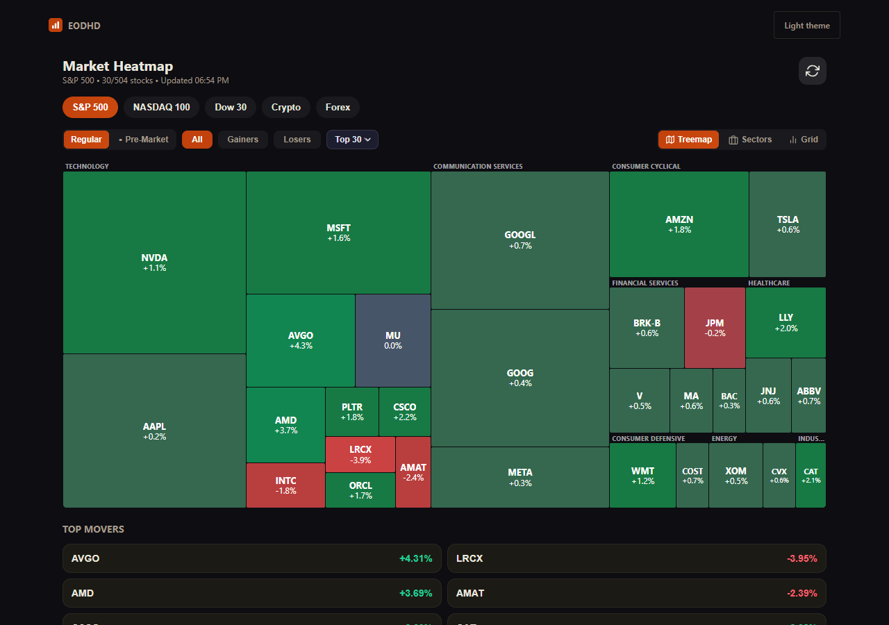

# EODHD Market Heatmap

A treemap of the market — size by market cap, colour by change — on your own EODHD key.



## Run it

```bash
git clone https://github.com/EodHistoricalData/eodhd-heatmap
cd eodhd-heatmap
npm ci                    # installs exactly what package-lock.json pins
cp .env.example .env      # Windows cmd: copy .env.example .env
npm start                 # http://localhost:5173
```

Put your EODHD API key in `.env` — [get one here](https://eodhd.com/register?utm_source=eodhd_oss&utm_medium=app&utm_campaign=heatmap&utm_content=readme).
The map needs index fundamentals and real-time quotes; the Screener API adds detail where the plan has it and is not required. Whatever else your key cannot reach is named on screen in EODHD's own words; a plan without the Screener gets the map without that detail, and no notice. There is no demo mode: without a key the app tells you so
and does nothing else.

Tested in current Chrome and Firefox on Node 20 and 24. Other browsers
may work but are not tested.

Port 5173 taken (Vite uses it too)? Add `PORT=5174` to `.env` — that works
the same in every shell. A `PORT` already set in your environment wins over
`.env`; change or remove that one instead.

Your key stays in `.env` on your machine. The small server in `server/`
adds it to outgoing requests, so it never reaches the browser and never
appears in a URL. That is also why there is a server at all — `eodhd.com`
does not send CORS headers, so a page cannot call it directly.

`npm test` runs that server's tests on Node's own test runner, with nothing
more to install: the key never reaches the browser, only the feeds these apps
use are forwarded, and a `429` passes its `Retry-After` on to the page.

## Links

The address bar always describes the screen you are on, so copying it gives
somebody else the same screen, and editing it moves the open app there. The
apps keep no history of their own: Back leaves the app rather than stepping
through the screens you visited.

## What it needs from your plan

The map is drawn from each index's member list (the index's fundamentals), priced with real-time quotes. The Screener API, on plans that include it, fills in extra rows; on a plan without it the map still draws.

When a request comes back `403`, the app shows you EODHD's own explanation of
what is missing rather than a generic error. The exception is the Screener API: the map only uses it for extra detail and draws the same tiles without it, so a plan without it gets no notice.

A cold load costs about 16 API calls, or about 46 while the US market is open; the free plan has 20 a day. The index's fundamentals give the member list (10 calls, kept for a day), one Screener API page adds detail (5) and the exchange's trading hours one more (1). While the market is open the 30 tiles on screen are also priced with live quotes, 1 call each. The prices per request are EODHD's own:
[API limits](https://eodhd.com/financial-apis/api-limits).

## Support

These are example apps, not a product with an SLA.

- Questions about data, keys or plans → **support@eodhistoricaldata.com**
- Bugs in this code → open an issue, we get to them as time allows
- Pull requests are welcome, and land upstream in our private source
  repository — this repo is generated, so edits made here would be overwritten.
  [CONTRIBUTING.md](CONTRIBUTING.md) says which files are which

## Licence

[MIT](LICENSE.md). Use it, change it, ship it in something you sell — the only
condition is that the copyright notice travels with the code. The same goes for
the two notices that travelled here with the icons: they are Feather and
Lucide, and their licences are in [THIRD-PARTY-NOTICES.md](THIRD-PARTY-NOTICES.md).

Two things the licence does not cover. It grants no rights in any trademark:
see [TRADEMARK.md](TRADEMARK.md). And it licenses this *code*, not the *data* —
what you may do with what the API returns is governed by your own EODHD
subscription.

---

© Unicorn Data Services · Lyon, France
